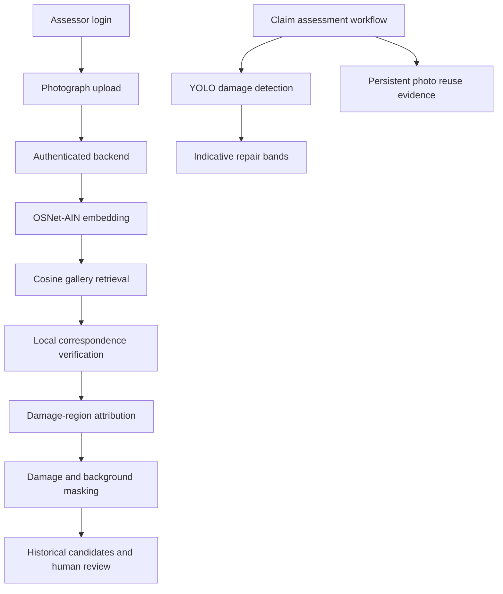

# IntelliClaim — Complete Project Documentation

> **Current handoff — 30 October 2026:** 72 local tests and the frontend production build pass. The four former capability gaps execute locally: nine-make ViT vehicle suggestions, offline plate OCR, official pretrained TruFor diagnostics and OSNet historical candidate retrieval. The core isolated Docker claim flow and separate Neon/private-Blob persistence checks passed. The staged Vercel build is READY, but hosted ML capabilities/claim inference failed verification; this is not a verified public application release. A 102.6-second local narrated walkthrough is available. [Component guide](docs/COMPONENT_GUIDE.md), [exact handoff](docs/INTEGRATION_HANDOFF.md), [research results](docs/RESEARCH_RESULTS.md), [publication inventory](docs/PUBLICATION.md).


**Snapshot: 30 October 2026.** This document consolidates the current implementation, actual results, verification, operating instructions and remaining work. It records a research prototype, not an industry-validated fraud-detection product.

## 1. Executive summary

IntelliClaim helps a motor-insurance investigator assess visible vehicle damage, find related photographs and inspect supporting evidence. It combines an existing claim-management application with real downloaded damage photographs and pretrained vision models.

The main completed result is an independently measured comparison on 420 Generali test-subset images: the authors' pretrained OSNet-AIN achieves 95.24% Recall@1 and 74.82% mAP, versus 90.48% and 58.67% for generic ResNet18. These are our measurements under an explicit leave-one-out protocol, not copied paper metrics. They validate a useful pretrained baseline on this sample; they do not establish a novel method or independent generalisation.

Our SIFT/RANSAC reranking experiment found no improvement. The masking pilot had limited detector/control coverage. A validation-selected no-match threshold failed to generalise. These negative results are retained rather than hidden.

The local assessor retrieval flow has now been verified in a real browser: login → original-photograph upload → authenticated backend → OSNet → historical candidates and diagnostic rendering with an interactive SVG correspondence-line overlay. The full LightGlue reranking experiment is now complete and showed no improvement under its validation-selected weight. A separate in-process claim smoke covers real detector inference, persistent photo reuse, invoice checks, PDF and assessor decisions. Dynamic claim-history photo ingestion into the live retrieval gallery has been implemented and verified. The final automated suite passed 72 checks and the frontend production build passed.

## 2. Current state at a glance

| Area | Completed and verified | Limits |
|---|---|---|
| Data acquisition | Generali paper/model archives; TQVCD public examples; pretrained ResNet, SuperPoint and LightGlue weights | Full CarDD/CDDM access not obtained; redistribution terms require review |
| Similarity model | Legacy checkpoint converted with restricted loader; exact OSNet-AIN architecture match | Authors' full preprocessing/protocol not reproduced; training overlap unverified |
| Research evaluation | Real-photo encoder comparison, identity-cluster bootstrap, SIFT reranking ablation, damage pilot, no-match stress test | Small public sample; no independent insurer validation |
| Retrieval app | Assessor/admin page, authenticated proxy, thumbnails, similarity, match counts, damage diagnostics, interactive correspondence-line visualizer, dynamic gallery ingestion | No automatic match/deny verdict; vehicle, OCR and TruFor checks integrated |
| Claim app | Claim submission, damage inference, stored reuse evidence, invoice arithmetic, graph, human review, one-click gallery indexing and PDF smoke-tested | Separate from photographic retrieval experiment; costs/severity are estimates |
| Access control | Anonymous retrieval 401; claimant retrieval 403; assessor login/search works | Development setup, not a production security audit |
| Checks | 72 checks pass; TypeScript/Vite build passes; live browser retrieval works | Core isolated Docker claim flow verified; hosted ML integration failed verification; LightGlue completed without improvement |
| Research contribution | Integrated workflow, reproducible evaluation and explicit failure analysis | No new architecture or improved reranking result established |

## 3. Workspace and preservation

- Active checkout: `/Users/gauraangthakkar/Documents/Codex/2026-10-30/new-chat-3/IPD`.
- Original checkout: `/Users/gauraangthakkar/Documents/Codex/2026-10-29/new-chat/IPD`.
- Source was copied to the active writable checkout to preserve the original project's substantial uncommitted changes. The original source was not overwritten.
- Python `.venv` and frontend `node_modules` are local links to the earlier checkout's dependencies. They are convenient here and **not portable**. Shared dependencies were installed from the user's Terminal.
- New databases, logs, generated demo accounts and Vite cache live under the active checkout's `var/` directory. The original application's ports were left alone.
- Current local ports: frontend **5183**, backend **8010**, ML **8011**.
- At this documentation snapshot the local launcher is running. This is not a hosted deployment, and it must be restarted if the process or computer stops.

## 4. User workflow and existing application components

### Investigator retrieval
1. An assessor/admin signs in and opens **Photo Retrieval**.
2. Upload a JPEG, PNG or WebP photograph, maximum 10 MB.
3. The backend enforces investigator access and forwards bytes to the ML service.
4. The service embeds the photograph with OSNet-AIN when its converted checkpoint exists. ResNet18 is the explicit baseline/fallback encoder.
5. Cosine similarity ranks photographs in the configured gallery.
6. SIFT/RANSAC, or explicitly enabled SuperPoint/LightGlue, supplies local correspondence evidence.
7. Optional damage diagnostics count correspondences within predicted damage boxes and compare damage/background masking effects.
8. The UI displays the top candidates, encoder, gallery size, similarity and evidence availability. A person reviews the candidates; no fraud probability is inferred.

### Claim investigation
- Claimants register/sign in, create vehicles and claims, upload images and submit.
- The existing YOLO checkpoint predicts six classes: dent, scratch, crack, glass shatter, lamp broken and tire flat.
- Estimated severity and indicative INR repair bands accompany detections; they are not validated repair quotations.
- Exact SHA-256 and perceptual pHash/dHash evidence persists across submissions.
- Narrative discrepancy checks are keyword baselines; vehicle suggestions, offline plate OCR and pretrained TruFor forensic diagnostics run locally; unsupported or low-evidence photographs remain inconclusive.
- Structured fields can trigger separate logistic and GraphSAGE research models. These outputs are not fused into a fabricated multimodal fraud probability.
- Invoice arithmetic flags discrepancies for review; it does not prove invoice fraud.
- Claim relationships, historical photo pairs, detector saliency, human decisions and PDF reports support the assessor workflow.
- SQLite/local files/inline processing form the verified lightweight mode. A separate isolated PostgreSQL/Redis/Celery/MinIO/Neo4j core claim smoke also passed. The later four evidence-model additions were verified locally; the hosted Vercel backend-to-ML flow failed verification.

## 5. Detailed architecture, datasets, methods and experiment record


### Submission scope
A research prototype for vehicle-damage evidence review. The system combines a pretrained damage detector, historical photograph retrieval, local correspondence evidence, model sensitivity diagnostics, and an assessor workflow. It does not establish fraudulent intent or automatically reject claims using image similarity.

### Architecture



### Data and provenance
- Generali authors' shared folder: https://drive.google.com/drive/folders/1VKMuGIejowfg7xylZsPKJ9VGdaxNWTYv
- Authors' implementation: https://github.com/Assicurazioni-Generali/damage-similarity
- Downloaded `paper.zip`: 567 original photographs in 43 folders and 420 test-subset images with 39 filename prefixes. These sets may overlap: do not count them as 987 independent observations or treat originals as a separate external evaluation.
- The authors' encoding notebook uses damage_id_image_id filenames. Our test labels use the prefix. Original folder-to-test identity mapping and every identity's physical semantics have not been independently audited.
- TQVCD public repository sample: 120 files, 113 exact-content-unique images. Contains exact duplicate files, including one cross-category pair. Full dataset access was not obtained.
- CarDD-compatible detector checkpoint supplied with the original project. The full CarDD corpus has not been obtained; detector accuracy is not measured by the application smoke tests.
- CDDM and full CarDD access require author licensing. They are not evaluated here.
- Dataset and checkpoint availability does not establish redistribution or commercial-use permission. Do not distribute raw archives with the submission without checking terms.

### Published methods reused
1. Generali pretrained similarity checkpoint: strictly loaded as OSNet-AIN x1.0 with 10,415 classifier outputs; inference uses the 512-dimensional embedding, 256x128 resize and ImageNet normalization. This preprocessing is our explicit choice, not a verified reproduction of the authors' full protocol.
2. ImageNet ResNet18 with classifier removed and L2-normalized embeddings.
3. Cosine similarity for candidate ranking.
4. SIFT/RANSAC geometric verification baseline; optional SuperPoint + LightGlue released weights.
5. Existing YOLO detector predicts normalized centre/width/height boxes; these are converted to pixel corners for evidence attribution.

OSNet architecture source is vendored from Kaiyang Zhou's deep-person-reid, with its MIT license. LightGlue: https://github.com/cvg/LightGlue . The legacy checkpoint was converted with a narrow pickle-global allowlist, then loaded as tensor state with weights_only=True and strict=True.

### Experiments and actual results

### Edited-photo reuse, separate from cross-view retrieval
113 unique real TQVCD source photographs; 28 validation sources, 85 test sources. Four generated transformations per test source: JPEG quality 35, brightness 0.65, 20% crop, horizontal reflection. Gallery size 113; 340 test queries. Exact duplicates grouped before splitting.

| Encoder | Recall@1 | Recall@5 |
|---|---:|---:|
| dHash | 68.82% | 76.47% |
| ResNet18 | 100.00% | 100.00% |

This small benchmark tests edits of real photographs, not new camera views. Near duplicates and source overlap with pretrained corpora remain possible. Its high performance does not imply insurer fraud accuracy.

### Generali downloaded test subset
420 images, 39 filename identities. Each query searches the remaining photographs; self-matches and exact duplicates excluded. All eligible images queried, no target-domain fine-tuning or threshold selection.

| Frozen encoder | Recall@1 | Recall@5 | mAP |
|---|---:|---:|---:|
| ResNet18 | 90.48% | 93.81% | 58.67% |
| Generali OSNet-AIN | 95.24% | 98.57% | 74.82% |

Paired identity-cluster bootstrap, 2,000 replicates, seed 42: Recall@1 delta +4.76 percentage points (95% interval +1.88 to +8.08); mAP delta +16.15 points (95% interval +11.85 to +21.11). These intervals describe sampling uncertainty under our protocol. The pretrained model's training overlap and shortcuts are not ruled out. This is not an independent external validation or a reproduction of reported paper metrics.

### Reranking ablation
10 validation identities, 29 test identities; disjoint partition-specific galleries; two queries per identity; top-five reranking. Score: cosine + alpha*log1p(SIFT/RANSAC inliers)/log(101), alpha selected on validation from {0,.025,.05,.1,.2,.4}. Ties prefer the smaller weight.

Validation selected alpha=0. Test Recall@1: 82.76% for both baseline and selected method, 58 test queries. **No improvement demonstrated.** Different gallery/query protocol means these numbers cannot be compared directly with the 420-query results. The zero-width bootstrap interval for this comparison is mechanical because alpha=0 selects the identical method; it is not evidence that all reranking methods have zero effect.


### Completed LightGlue reranking experiment
The identity-separated top-five reranking experiment completed with 20 validation and 58 test queries (390 pairs across 78 queries), 256 SuperPoint keypoints, a real 640-pixel maximum edge, and per-image feature caching. Extraction covered 256 unique photographs. Total runtime was 212.36 seconds on CPU. The original interrupted implementation silently let SuperPoint upscale inputs to 1024; the completed run explicitly disables that second resize. Its correspondence counts therefore need not equal the older partial run.

All six validation weights tied at 90% Recall@1, so the predefined smallest-weight tie break selected alpha=0. Test Recall@1 was 82.76% and truncated MRR@5 was 83.76% for both baseline and selected reranking. The [0,0] bootstrap interval is mechanical because the selected method is identical to baseline. This experiment uses the cached ResNet18 candidate rankings and does not establish an improvement over OSNet. Full configuration, embedding-cache SHA-256, partitions, and every candidate match count are retained in `research/results/lightglue_reranking_evaluation.json`.

### Damage evidence pilot
Eight deterministically selected test queries, top-three candidates each: 24 pairs. Damage detected in both images in 12 pairs; equal-area non-overlapping background controls available for five pairs. Results mixed. This pilot describes feasibility and missing evidence, not an accuracy improvement.

Masking uses query mean RGB, changes the query only, and compares one highest-confidence predicted damage rectangle against an equal-sized background rectangle. It measures sensitivity to an artificial perturbation; do not call it causal proof or calibrated certainty. Correspondence diagnostics inspect at most 100 returned points.

### Contributions we can defend
- Engineering: integrated evidence workflow combining published models, persistent photograph evidence, authenticated review and explicit unavailable states.
- Evaluation: reproducible real-image encoder comparison, exact-duplicate audit, identity-separated reranking experiment, masking diagnostics, and documented negative findings.
- Proposed research extension: damage-aware verification and abstention. **No new state-of-the-art method, novel architecture, or improved reranking performance has been established.**

### Boundaries
Public tabular fraud and GraphSAGE experiments remain separate from the images: no authentic image/claim pairing exists. Feature-neighbour graph edges are not proof of collusion. Damage severity and INR repair costs are estimates, not validated quotations. Missing EXIF is not evidence of fraud. OCR, learned tampering and vehicle make checks may be unavailable.

### Reproduce
From the project root, with Python 3.11 and provisioned assets:

```bash
.venv/bin/python research/scripts/benchmark_reuse.py --resnet
.venv/bin/python scripts/convert_osnet_checkpoint.py
.venv/bin/python research/scripts/benchmark_generali.py
.venv/bin/python research/scripts/benchmark_osnet.py
.venv/bin/python research/scripts/compare_encoders.py
.venv/bin/python research/scripts/benchmark_reranking.py
.venv/bin/python research/scripts/benchmark_damage_evidence.py
.venv/bin/python -m unittest discover -s tests -v
npm run build --prefix frontend
```

Raw outputs are in research/results. The full LightGlue reranking run completed on 30 October 2026: 78 queries and 390 candidate pairs, with 20 validation queries and 58 test queries. Results are in research/results/lightglue_reranking_evaluation.json. Validation selected alpha=0; baseline and selected test Recall@1 both equal 82.76%. This experiment uses frozen ResNet18 candidates, not OSNet candidates. OSNet's separate benchmark and SIFT reranking also completed.

### Open-set threshold stress test
Separate 10-identity validation and 29-identity test galleries, all 121 validation and 299 test images. For the no-match condition, remove every gallery image with the query identity. Select a similarity threshold at the 95th percentile of validation maximum impostor scores, then freeze it.

| Encoder | Test accepted-match coverage | Precision among accepted | No-match false alerts |
|---|---:|---:|---:|
| ResNet18 | 89.63% | 94.78% | 32.78% |
| OSNet-AIN | 94.65% | 97.53% | 38.46% |

**The threshold does not generalize.** Test galleries contain more identities and images, and the small validation set does not capture their hard negatives. OSNet is better on closed-set retrieval but not automatically safer at rejecting unmatched queries. Do not deploy these thresholds as fraud or identity decisions. The app deliberately returns candidates for human review without automatic acceptance. This is a useful negative finding, not a successful abstention contribution.

### Final verification
- 72 unit/integration checks pass; frontend production build passes.
- Real live services: frontend 5183, backend 8010, ML 8011 each return HTTP 200.
- Investigator retrieval access: unauthenticated request 401; claimant request 403.
- Live browser: assessor login, upload of an original Generali photograph, backend request, OSNet retrieval over 420 photos and rendered historical candidates verified. SIFT/RANSAC and damage diagnostics used in this browser run. Screenshot retained locally under research/results/browser_retrieval_verified.png.
- Separate claim-flow smoke passed with local SQL/files: real detector, persistent image reuse, PDF export and assessor decision. This is a synthetic demonstration workflow, not real insurer outcome validation.
- The isolated Docker core claim smoke passed with real PostgreSQL, Redis/Celery, MinIO and Neo4j. Hosted Vercel capability/claim tests failed; see the current handoff.

## 6. Separate structured-data experiments

The inherited public `insurance_claims.csv` contains 1,000 records (247 fraud labels, 753 non-fraud labels). There is no authentic pairing between these records and the damage images. These experiments are separate benchmarks and must not be described as a validated multimodal insurer model.

| Model | Held-out records | Average precision | ROC-AUC | Brier score |
|---|---:|---:|---:|---:|
| L2 logistic regression | 201 | 0.6695 | 0.8785 | 0.1200 |
| GraphSAGE baseline | 201 | 0.7245 | 0.9008 | 0.1004 |

These are stored exploratory single-split results from the existing training scripts, not newly run multi-seed external validation. Thresholds were selected on validation. GraphSAGE edges connect eight nearest training feature vectors; they do not represent verified fraud rings or real collusion relationships. Logistic explanations add contributions in log-odds space and reconstruct the model output. Calibration and prospective insurer performance remain unestablished.

## 7. What changed during this session

| Component | Work completed |
|---|---|
| Acquisition | Added pinned TQVCD download/integrity checks and duplicate audit; provisioning for ResNet, LightGlue and released Generali assets |
| Package management | Fixed absent pip handling by using installed uv; dependent downloads skip failed installation steps |
| Duplicate archive | Identified the Drive folder's separately listed Chinese-suffixed model copy; downloaded only paper.zip after the original model archive completed |
| Archive audit | Inspected and extracted archives, checked member paths, inventoried images and candidate identity groups |
| Checkpoint compatibility | Converted the legacy archive using a narrow pickle-global allowlist; identified OSNet-AIN after standard OSNet failed strict matching; saved tensor-only state and loaded strictly |
| Published architecture | Vendored OSNet source and retained its MIT license; generic OSNet source remains reference code, OSNet-AIN is the working checkpoint architecture |
| Retrieval engine | Added gallery deduplication, pretrained embeddings, cosine ranking, candidate thumbnails, local verification, diagnostic evidence, dynamic image ingestion (`add_image`) and runtime gallery statistics (`stats`) |
| API | Added ML `/retrieval/search`, `/retrieval/gallery/add`, `/retrieval/stats` and authenticated backend `/api/v1/intelligence/retrieval/search`, `/retrieval/gallery/add`, `/retrieval/stats` |
| Frontend | Added Photo Retrieval route/navigation, upload, loading/error states, candidate cards, masking diagnostics, interactive SVG `CorrespondenceOverlay` visualizer, dynamic gallery ingest panel, and `AddToGalleryButton` in claim review |
| Correctness | Fixed detector normalized centre-box to pixel-corner conversion and added a regression test; scaled local-match coordinates consistently |
| Performance | Bounded image dimensions for local features/detection, controlled CPU threads, incremental vector stacking without re-embedding, and documented LightGlue limits |
| Runtime | Isolated local ports, gave Vite its own cache and fixed internal HTTPX calls picking up an unsupported environment proxy |
| Evaluation | Added scripts and raw JSON for photo reuse, Generali encoders, bootstrap comparison, reranking, damage evidence and no-match rejection |
| Verification | Ran final automated checks (72 passing), production build, real-image API smoke, claim-flow smoke, dynamic ingestion smoke, and actual browser retrieval |

An early progress message incorrectly asserted the OSNet tensor match before checking it. That was corrected: standard OSNet failed; the actual successful strict load used OSNet-AIN. No result is based on a partially loaded architecture.

## 8. Important files and outputs

All paths below are relative to the active project root.

| Path | Purpose |
|---|---|
| `scripts/dev.py` | Local environment, doctor, demo accounts and three-service launcher |
| `scripts/provision_retrieval.py` | Network-enabled package/model/dataset acquisition |
| `scripts/convert_osnet_checkpoint.py` | Restricted legacy checkpoint conversion |
| `ml/retrieval/engine.py` | Embeddings, gallery ranking and local verification |
| `ml/retrieval/damage_evidence.py` | Predicted-damage attribution and masking diagnostics |
| `ml/retrieval/osnet_ain_arch.py` | Working published OSNet-AIN architecture |
| `ml/retrieval/OSNET_LICENSE` | Upstream architecture license |
| `ml/serve.py` | ML service and retrieval endpoint |
| `backend/app/api/intelligence.py` | Investigator-protected retrieval proxy |
| `frontend/src/pages/RetrievalPage.tsx` | Retrieval UI with query preview, candidate cards and ingest panel |
| `frontend/src/components/CorrespondenceOverlay.tsx` | Interactive SVG correspondence-line overlay for query vs candidate matches |
| `frontend/src/components/AddToGalleryButton.tsx` | One-click claim image indexing into historical retrieval gallery |
| `research/scripts/acquire_tqvcd.py` | Pinned sample acquisition and exact-duplicate audit |
| `research/scripts/benchmark_reuse.py` | Edited-photo reuse benchmark |
| `research/scripts/benchmark_generali.py` | Real-photo ResNet benchmark |
| `research/scripts/benchmark_osnet.py` | Same-protocol OSNet-AIN benchmark |
| `research/scripts/compare_encoders.py` | Paired identity-cluster bootstrap |
| `research/scripts/benchmark_reranking.py` | Validation-selected SIFT/RANSAC reranking |
| `research/scripts/benchmark_lightglue_reranking.py` | Completed learned-reranking experiment; validation selects zero weight, no test improvement |
| `research/scripts/benchmark_damage_evidence.py` | Detector/masking pilot |
| `research/scripts/benchmark_abstention.py` | No-match threshold stress test |
| `scripts/smoke_retrieval.py` | Real-model retrieval API smoke with temporary gallery |
| `scripts/smoke_full_flow.py` | Claim workflow in-process integration smoke |
| `scripts/verify_live_services.py` | Live readiness and access-control probes |
| `research/results/generali_inventory.json` | Extracted-image inventory |
| `research/results/tqvcd_audit.json` | Source hashes and duplicate groups |
| `research/results/reuse_benchmark.json` | Edited-photo metrics and query results |
| `research/results/generali_resnet18.json` | ResNet real-photo metrics and query rankings |
| `research/results/generali_osnet.json` | OSNet real-photo metrics and query rankings |
| `research/results/osnet_vs_resnet.json` | Paired comparison and bootstrap intervals |
| `research/results/reranking_evaluation.json` | Completed negative reranking result |
| `research/results/damage_evidence_pilot.json` | Per-pair damage/masking evidence |
| `research/results/abstention_evaluation.json` | Failed threshold transfer result |
| `research/results/live_verification.json` | Service and role-access status |
| `research/results/browser_retrieval_verified.png` | Locally saved screenshot of actual rendered results |
| `var/gauraang_real_flow.json` | Separate claim smoke summary |
| `docs/TABULAR_EVALUATION.json` / `docs/GRAPH_EVALUATION.json` | Separate structured-model results |

`acquisition_status.json` may still reflect an older failed provisioning run because some assets were subsequently downloaded by targeted Terminal commands. Direct archive/model inspection and completed experiment files establish the later successful state. Likewise, the claim smoke summary's `live_browser_tested: false` describes that in-process script; live retrieval was verified separately and is not covered by that flag.

## 9. Setup, demo and reproduction


### Start

```bash
cd /Users/gauraangthakkar/Documents/Codex/2026-10-30/new-chat-3/IPD
python3 scripts/dev.py doctor
python3 scripts/dev.py start
```

Open http://127.0.0.1:5183 . This checkout uses backend 8010 and ML 8011 to avoid the older project's ports. Override FRONTEND_PORT, BACKEND_PORT and ML_PORT if occupied. Logs: var/frontend.log, var/backend.log, var/ml.log. Stop the launcher with Ctrl+C; it owns and stops its three child services.

Demo assessor credentials are in var/demo_accounts.json. Do not include credentials in the submitted source archive. Assessor/admin users can open Photo Retrieval; claimants are denied by the backend.

The current checkout uses shared local Python and Node dependencies from the earlier checkout. On another machine run scripts/dev.py setup --with-vision and scripts/provision_retrieval.py --generali --lightglue in a network-enabled Terminal, inspect/extract downloaded archives, and convert the OSNet checkpoint. Do not assume the local dependency links are portable.

### Three-minute demonstration
1. Explain: this retrieves photographic evidence for human investigation, not fraud verdicts.
2. Log in as assessor; open Photo Retrieval.
3. Upload a photograph from data/raw/generali/extracted/paper/original. First request encodes the gallery and can take longer than subsequent requests.
4. Show the encoder name, historical photographs, similarity and local correspondence counts. Large similarity values are not probabilities.
5. Explain damage masking versus equal-area background masking. Missing boxes/control regions produce unavailable evidence.
6. Show the paired encoder results in research/results/osnet_vs_resnet.json and the no-improvement reranking result.
7. Show the separate claim assessment flow if required; use generated synthetic accounts and data/demo/repository_sample_scratch.jpg.

Photo Retrieval uses the downloaded test subset as a demonstration gallery; these are not authentic historical claims. Uploading an image already in the gallery can retrieve itself; the offline research benchmarks exclude this. Do not use an exact reupload as proof of cross-view recognition.

### Matcher settings
Default SIFT/RANSAC is a CPU baseline. For learned local matching:

```bash
RETRIEVAL_MATCHER=lightglue RETRIEVAL_KEYPOINTS=256 RETRIEVAL_EDGE=640 python3 scripts/dev.py start
```

LightGlue uses the configured image edge directly; SuperPoint automatic resizing is disabled to avoid silently upscaling back to 1024. The offline experiment caches extracted features per photograph, completing in 212.36 seconds with 256 keypoints and a 640-pixel edge. It supplies local correspondences, not a validated identity decision. Damage diagnostics are enabled by the launcher; set RETRIEVAL_DAMAGE_EVIDENCE=0 to disable extra detector/masking work. Set RETRIEVAL_ENCODER=resnet to reproduce the generic encoder in the app; OSNet is used by default when its converted checkpoint exists.

### Recovery
- Busy port: stop only your known launcher, or override ports. Never kill unrelated processes.
- Model unavailable: inspect the ML log and provision weights. No random-weight embedding or generic object detector is substituted as a trained damage model.
- Startup health briefly unavailable: wait for ML application startup in var/ml.log; avoid submitting during model initialization.
- Search failure: inspect backend and ML logs. Local service requests explicitly ignore system proxy settings.
- CDDM/CarDD access: obtain author permission; do not claim those full corpora are installed.

### Validation evidence
- Full application smoke: scripts/smoke_full_flow.py (in-process transport; no browser).
- Retrieval API smoke: scripts/smoke_retrieval.py (real images/models; small temporary gallery).
- Browser check must be recorded separately; an in-process smoke does not prove a browser flow.

## 10. Security, reproducibility and presentation guidance

- Use the launcher-generated secret and synthetic demo accounts; do not publish `var/demo_accounts.json`, `var/dev.secret`, tokens, uploads or user databases.
- Keep raw images/checkpoints out of a public source submission until terms are checked. Downloading a public link is not a redistribution license.
- Do not claim the local dependency links will work on another machine. Install Python 3.11 dependencies and Node packages in a fresh environment.
- Report actual independent protocols, gallery sizes and model preprocessing. Do not compare our leave-one-out metrics directly with a paper using a different query/gallery split.
- Retain failed/negative experiments. Do not cherry-pick a favorable masking example as proof of retrieval improvement.
- Source identity overlap with pretrained training remains unverified, so call the results a public-benchmark reproduction-style evaluation, not independent generalisation.
- The running page's historical gallery is a research demonstration gallery, not authentic historical insurance records.

## 11. Remaining work and honest readiness assessment

### Completed for the local prototype
- Real datasets/checkpoints acquired and inspected.
- Working pretrained OSNet retrieval, local-feature diagnostics and investigator UI.
- Interactive SVG correspondence-line overlay (`CorrespondenceOverlay.tsx`) connecting matched keypoints between query and candidates.
- Dynamic claim-history gallery ingestion and reindexing (`/retrieval/gallery/add`, `/retrieval/stats`, and `AddToGalleryButton.tsx`).
- Actual browser/backend/ML integration demonstrated.
- Separate claim workflow smoke verified.
- Reproducible encoder evaluation and negative experiments documented, including the completed LightGlue reranking experiment.
- Final checks (72 automated tests passing), production build and operating instructions available.

### Not completed or not established
1. A new retrieval method outperforming the published OSNet baseline: **not demonstrated**.
2. LightGlue reranking improvement: **not demonstrated**. The full experiment is now complete (78 queries, 390 pairs, 212.36 seconds); validation selected alpha=0 and test Recall@1 remained 82.76%.
3. Reliable open-set abstention: original transfer failed; a completed fixed-gallery finite-sample continuation still has insufficient independent-group evidence. It is not enabled as an automatic decision.
4. Full authors' protocol/preprocessing reproduction, independently audited identity semantics and pretrained-training overlap checks.
5. Independent external same-damage evaluation, full CarDD/CDDM access and detector accuracy evaluation.
6. Verified production release: Vercel containers build successfully, but hosted ML capabilities were unavailable and a claim timed out. Production inference load/security testing, calibrated costs/severity and insurer fraud validation remain open.
7. A continuous narrated screen recording is not created. A 102.6-second local edited walkthrough of actual browser screen captures, with synthesized narration, transcript and captions, has been produced.

**Ready claim:** a working local research prototype with real data, published pretrained models, measured results, investigator workflow and reproducible limitations.

**Not a defensible claim:** a novel state-of-the-art retrieval method, industry-validated fraud detector or proven automatic insurance decision system.

## 12. Primary references

- Generali damage-similarity implementation and released assets: https://github.com/Assicurazioni-Generali/damage-similarity
- Maiano et al., A deep-learning-based antifraud system for car-insurance claims (2023): https://doi.org/10.1016/j.eswa.2023.120644
- OSNet / deep-person-reid implementation: https://github.com/KaiyangZhou/deep-person-reid
- LightGlue, ICCV 2023, official implementation and weights: https://github.com/cvg/LightGlue
- CarDD official dataset page: https://cardd-ustc.github.io/
- CDDM official source/access instructions: https://github.com/SCUT-CCNL/CDDM
- TQVCD official public repository: https://github.com/dxlabskku/TQVCD

This document records what was implemented and measured. Access status, validation limits and incomplete experiments take precedence over earlier exploratory plans or optimistic progress statements.

## 13. Continuation and completion verification — 30 October 2026

- Completed the previously interrupted LightGlue experiment; retained its negative result and explicit ResNet18 protocol.
- Fixed SuperPoint's hidden 1024-pixel upscale and reused per-image features in the experiment.
- Hardened gallery ingestion: decoded-format extensions, bounded safe filenames, preserved filename collisions, embeddings and stacked vectors computed before disk mutation, atomic file replacement, duplicate detection after restart, and no index mutation on failed embeddings.
- Added offline JPEG/PNG/WebP upload decoding through explicit Pillow format decoders. This avoids Ultralytics' global `Image.open` patch attempting HEIF dependency installation on invalid uploads. Invalid uploads return 422 through the authenticated backend.
- Added regression checks for restart persistence, failed-embedding recovery, unsupported formats, matching resolution, and third-party Pillow monkey patches. The complete suite passes **72 tests**; TypeScript/Vite production build passes.
- Updated correspondence layout tracking with ResizeObserver; preview object URLs are released; invalid coordinate dimensions are guarded; gallery ingestion supports cold-start timeouts; claim-photo indexing can retry failures and refreshes gallery stats.
- Before a model is loaded, gallery statistics report a null embedding instead of incorrectly identifying the default encoder as the loaded model.
- Real-model LightGlue retrieval API smoke and full claim workflow smoke passed. These in-process checks do not by themselves establish browser behavior.
- Live browser verification repeated with an original Generali photograph: OSNet returned candidates, SIFT/RANSAC and damage diagnostics rendered, correspondence expansion worked, and Hide/Show lines toggled correctly. Screenshot: `research/results/completion_correspondence_verified.png`.
- Live service and gallery-ingestion evidence is retained separately in `research/results/live_verification.json` and `research/results/gallery_ingestion_verification.json`. Re-run `scripts/verify_live_services.py` and `scripts/verify_gallery_ingestion.py` against the running local launcher. The ingestion smoke adds one deterministic generated PNG to the mutable demo gallery; it does not modify the benchmark corpus.

Remaining research and release gates: independently licensed external same-damage data, audited identity/training provenance, validated abstention, insurer outcome and detector/cost validation, the hosted ML integration repair, production inference load/security testing, and an optional continuous screen recording beyond the completed narrated walkthrough. These are not satisfied by passing local tests or completing a negative experiment.

## 14. Evidence-model integration and cloud/release handoff

The complete current explanation of each component is in `docs/COMPONENT_GUIDE.md`. This section supersedes earlier statements that vehicle/OCR/learned tampering were unimplemented or that Docker was unverified.

- **Vehicle verification:** a locally provisioned Apache-licensed ViT safetensors checkpoint supports nine makes and executes without remote model code. Unsupported makes/low-score damage close-ups remain inconclusive. Model scores are uncalibrated.
- **Plate OCR:** official EasyOCR CRAFT/English-g2 weights are provisioned once; runtime downloads are disabled. Confidence-gated Indian registration candidates retain raw OCR and explicit glyph-normalization context. A positive synthetic plate fixture passed; an unreadable real photograph stays inconclusive.
- **Tampering:** official pretrained TruFor returns a model score, localization map and reliability summary. Its official archive checksum and source revision are recorded; a restricted conversion produces a pure tensor checkpoint for strict loading. The retained license permits informational/nonprofit use only. There is no calibrated insurance-authenticity verdict.
- **Historical damage-photo matching:** OSNet candidates now participate in claim evidence as well as standalone retrieval. The dashboard names this candidate retrieval, rather than asserting physical-damage identity.
- **Assessor inspector:** `PhotoEvidenceInspector.tsx` and the authenticated `/intelligence/images/{image_id}/evidence` proxy show these real outputs for stored photographs. Actual local browser inspection passed, including an inconclusive make/plate result, TruFor map and three historical candidates.
- **Cloud persistence:** PostgreSQL-backed ML photo history/gallery supports independent instances; private Vercel Blob stores originals/overlays. Key-scoped expiring app media signatures prevent reuse for a different photo. Real Neon/Blob probes passed and temporary synthetic rows/objects were removed.
- **Hosted deployment:** project `gst8/intelliclaim`, staged deployment `dpl_AsBwuxtHyTczjN9EkruqBw5KwAzx`, build READY. Login page rendered and private demonstration accounts were provisioned. Capability verification failed on a missing `damage_detection` key, and a hosted synthetic claim timed out. Binding/routing/startup/resource/health-timeout root cause remains unconfirmed. No successful cloud-flow report or production promotion is claimed.
- **Research continuation:** fixed-gallery abstention and 113-image external-source stress tests completed. The former does not establish reliable 5% rejection; the latter has no audited matching same-damage identity labels. Full CarDD/CDDM access still needs the authors' grant.
- **Narration:** `submission/IntelliClaim_Narrated_Walkthrough.mp4` is a 102.6-second edited capture walkthrough, with synthesized Aman voice and captions. Audio/video streams were checked and narration measured non-silent. It is not a continuous live recording. The local video/screenshots contain research imagery and are excluded from the public source pending redistribution terms; their transcript/captions/manifest are included.

Current verification is summarized by `research/results/release_verification.json`; protocol details and exact results remain in the corresponding research JSON reports. The original source checkout and its substantial uncommitted work remain preserved. Publication uses a separate checkout of the verified canonical GitHub repository.
