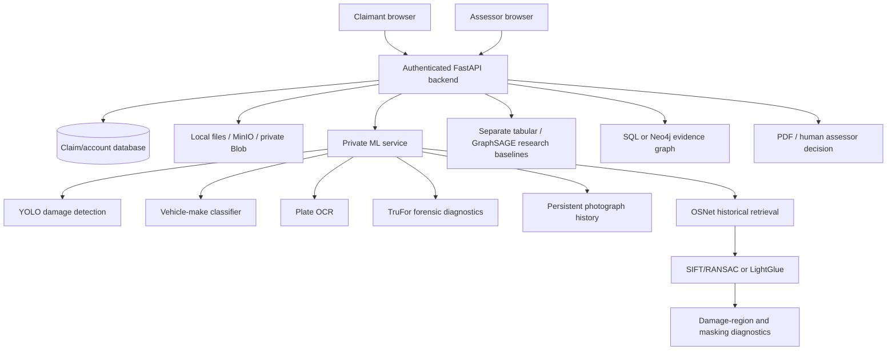

# Component guide

This guide explains the implemented system as of 30 October 2026. “Available” means the installed component can execute; it does not mean its accuracy, calibration or suitability for an insurance decision has been validated.

## 1. Architecture and evidence flow

The live claims database, the research evaluation corpora, and the feature-neighbour graph benchmark are different data sources. They are not merged into fabricated image/claim pairs.

## 2. Web application

**Source:** `frontend/src/App.tsx`, `frontend/src/components/Layout.tsx`, `frontend/src/pages/`.

React/TypeScript/Vite provides login, dashboards, vehicles/claim intake, claim details, review queue, evidence graph and photograph retrieval. Zustand keeps the auth token and role; TanStack Query manages API queries and invalidation. `frontend/src/lib/api.ts` adds the bearer token to `/api/v1` requests and handles expired authentication.

Claimants see their own claims. Assessors/admins receive investigator controls. The backend independently enforces role checks; hidden UI controls do not substitute for authorization. `ComponentStatus.tsx` renders actual ML capability responses and their limitations. `InfrastructureStatus.tsx` renders live service probes.

## 3. Backend API, authentication and persistence

**Source:** `backend/app/main.py`, `api/router.py`, `api/auth.py`, `core/auth.py`, `core/config.py`, `core/database.py`, `models/`.

FastAPI validates request schemas and exposes account, vehicle, claim, review, capability and investigator endpoints. Passwords are bcrypt-hashed. JWTs carry user/role information; public registration cannot self-assign an assessor/admin role. SQLAlchemy stores users, vehicles, claims, claim images, assessments, investigator results and graph synchronization state. SQLite is the verified lightweight mode; PostgreSQL is used in the tested isolated stack and provisioned cloud database.

The database adapter supports TLS PostgreSQL URLs supplied by Neon and disables asyncpg's statement cache for pooled connections. Local development table creation remains in startup; production schema evolution still needs deliberate migration/version management.

## 4. Claim orchestration and job execution

**Source:** `backend/app/services/claim_processor.py`, `assessment_results.py`, `backend/app/worker/`, `ml/pipeline.py`.

Submitting a claim calls the same evidence pipeline either inline or through Celery/Redis. Each photograph is assessed independently. Failures in one component leave other evidence available. The processor persists detections, evidence indicators, indicative costs and review status. Duplicate/context discrepancies can route a claim to review, but no image similarity value becomes a fraud probability or automatic denial.

`AssessmentPipeline` accepts injected dependencies for tests. It coordinates damage, history, keyword consistency, vehicle/plate checks, TruFor and optional historical retrieval. Results expose explicit unavailable or inconclusive evidence rather than fabricated fallback outputs.

## 5. Damage detector

**Source:** `ml/detection/detector.py`, `predict.py`, `severity.py`.

The supplied YOLO checkpoint predicts six classes: dent, scratch, crack, glass shatter, lamp broken and tire flat. Checkpoint class names must match that vocabulary. Missing/incompatible damage weights do not trigger a generic object-detection substitution. Normalized centre/width/height boxes are converted correctly for pixel-based diagnostic attribution.

Outputs are bounding boxes, labels and detector confidence. Real inference and API integration have been smoke-tested; no independent CarDD test-set detector accuracy is claimed.

## 6. Severity and repair-cost estimates

**Source:** `ml/detection/severity.py`, `ml/cost/estimator.py`.

Severity is an area-based heuristic derived from visible detections, not a separately validated learned model. The estimator maps damage/severity and vehicle/region inputs to indicative INR repair bands and a breakdown. Missing/no visible damage does not manufacture “minor” severity or a price. These values require workshop assessment and are not validated repair quotations.

## 7. Vehicle verification

**Source:** `ml/fraud/vehicle_classifier.py`, `scripts/provision_evidence_models.py`.

The installed ViT classifier is `nenzilea/car-classification`, revision `40b07a61c3125b0be2e607efe6581d4e64c8b801`, loaded from local safetensors without remote model code. It supports nine makes: BMW, Dodge, Ferrari, Ford, Jeep, Lamborghini, Porsche, Rolls-Royce and Toyota. The original EfficientNet loader remains for a separately provisioned compatible checkpoint.

The image produces make suggestions and softmax model scores. An unsupported claimed make or low score yields an inconclusive check. A confident discrepancy is evidence for manual review, not proof of a different insured vehicle. Shared corporate ownership/design language does not make Volkswagen and Skoda equivalent. Damage close-ups often contain insufficient identifying context.

## 8. Registration-plate OCR

**Source:** `ml/fraud/plate_reader.py`.

EasyOCR uses the official CRAFT detector and English generation-2 recognizer. Setup downloads the weights; runtime uses `download_enabled=False`. Text is confidence-gated and searched for Indian registration patterns. Common O/Q/I/Z/S/B glyph confusions are corrected only in digit positions, with raw OCR evidence retained. A synthetic `MH02AB1234` fixture was successfully read.

No readable plate, an unsupported plate format or a missing claimed registration is inconclusive. OCR scores are uncalibrated; a mismatch needs visual confirmation. It is not a legal vehicle-identity certification.

## 9. Photograph tampering diagnostics

**Source:** `ml/fraud/tamper_detector.py`, `ml/vendor/trufor/`, `ml/safe_checkpoint.py`.

The official pretrained TruFor model supplies a whole-image model score, a localization heatmap and a reliability summary. The adapter bounds images to a 768-pixel edge and retains the authors' `/256` input scaling. The official archive checksum is verified, legacy weights are converted with a narrow pickle allowlist, and the resulting tensor-only dictionary is loaded strictly with `weights_only=True`.

The detector executes on real photographs; its scores are not calibrated authenticity probabilities and have not been evaluated on insurance outcomes. Upstream software is licensed for informational/nonprofit use only. Copyright notices, source revision and licenses are retained. The app presents informational forensic evidence and does not declare a photograph authentic, fraudulent or legally conclusive.

## 10. Persistent photograph reuse

**Source:** `ml/fraud/image_forensics.py`, `image_history.py`, `postgres_history.py`.

SHA-256 finds exact byte reuse; pHash/dHash supply perceptual candidates. Both perceptual distances must satisfy the configured threshold. Same-claim retries are idempotent, matches point to other claims, and missing history is reported as unavailable. EXIF and JPEG recompression differences are informational diagnostics; missing EXIF has no fraud penalty.

SQLite WAL is the single-host local history. PostgreSQL history uses transaction-scoped locking for shared lookup/registration across independent cloud instances. This detects photograph reuse, not necessarily a recurrence of the same physical damage under new viewpoints.

## 11. Historical photograph retrieval

**Source:** `ml/retrieval/engine.py`, `osnet_ain_arch.py`, `postgres_engine.py`.

A frozen encoder embeds a query and gallery photographs, normalizes vectors and ranks cosine similarity. The preferred provisioned encoder is released OSNet-AIN x1.0 (512-dimensional embedding; explicit 256×128 resize and ImageNet normalization); provisioned ResNet18 is an explicitly labelled baseline/fallback. No random-weight encoder is silently substituted.

The gallery stores photographs, not verified physical-damage identities. `add_image` validates image bytes, uses decoded-format extensions, detects SHA-256 duplicates and appends one vector without re-embedding every existing image. It computes embeddings before publication and avoids partial local index changes on failure. Local writes use atomic replacement. PostgreSQL stores durable gallery content and vectors for independent instances; `/tmp` files are only caches.

`POST /retrieval/search`, `POST /retrieval/gallery/add` and `GET /retrieval/stats` belong to the ML service. Authenticated assessor/admin proxies live below `/api/v1/intelligence/retrieval/`. Claim-image ingestion resolves the stored photograph through the backend. The mutable demonstration gallery is separate from frozen evaluation manifests.

## 12. Local matching and correspondence visualization

**Source:** `ml/retrieval/engine.py`, `frontend/src/components/CorrespondenceOverlay.tsx`, `pages/RetrievalPage.tsx`.

SIFT descriptors with ratio filtering and RANSAC homography provide an explicit geometric baseline. Optional SuperPoint/LightGlue provides learned local correspondences. SuperPoint's implicit upscale is disabled so the configured edge bound is real. The completed LightGlue experiment caches features per image.

The browser renders query/candidate keypoints and connecting SVG lines, scales coordinates to rendered dimensions, handles container resizing and supports Hide/Show lines. At most 100 correspondences are displayed. Matching background or undamaged bodywork can create correspondences; planar geometry can also fail on genuine cross-view matches. Local-feature support is not proof of the same damage.

## 13. Damage-region attribution and masking

**Source:** `ml/retrieval/damage_evidence.py`.

Predicted damage rectangles are mapped into the match-coordinate system. Diagnostics count returned correspondences in predicted damage and compare query-only damage masking against an equal-area non-overlapping background control. Missing boxes or an unavailable background control remain explicit.

This measures sensitivity to an artificial perturbation. It is not causal proof, a calibrated confidence estimate or demonstrated retrieval improvement. The existing pilot has only eight queries/24 candidate pairs and limited control coverage.

## 14. Assessor photograph inspector

**Source:** `frontend/src/components/PhotoEvidenceInspector.tsx`, `backend/app/api/intelligence.py`, `ml/serve.py`.

On a stored claim photograph, **Inspect vehicle, plate, tampering and history** requests the authenticated backend, which resolves claim/vehicle facts, downloads the stored photograph and calls the private ML inspector. The panel shows vehicle suggestions/inconclusive text, plate candidates, TruFor's model score/map, and historical thumbnails/similarity.

The request is read-only with respect to the claim decision. It does not transform model outputs into a fraud percentage. This complete interaction was verified in a local browser.

## 15. Narrative consistency

**Source:** `ml/fraud/consistency_checker.py`.

Keyword checks compare the description with available visible damage classes. They are a baseline, not a trained language model or deception detector. A lack of observed discrepancy is not evidence that a claim is genuine; unavailable image evidence cannot support a manufactured narrative conclusion.

## 16. Structured-data research models

**Source:** `ml/tabular/model.py`, `graph.py`, `scripts/train_tabular.py`, `train_graph.py`, `backend/app/services/structured_assessment.py`.

The logistic baseline uses seven documented fields with training-only preprocessing. Its additive explanations reconstruct log-odds, not unsupported probability attributions. The GraphSAGE baseline is an inductive feature-neighbour experiment with training-reference neighbours; these are not verified collusion edges.

The 1,000-row public-repository CSV has no authentic pairing with the vehicle photographs. Results are separate single-split experiments. Hobbies and unverified identifiers need ablation/fairness/provenance review. The portable JSON artifacts are included; the raw teammate CSV stays local pending redistribution clearance.

## 17. Invoice arithmetic and investigator dossier

**Source:** `backend/app/services/invoice.py`, `models/intelligence.py`, `api/intelligence.py`, `frontend/src/components/IntelligenceDossier.tsx`.

A structured line parser extracts description, quantity and unit price, calculates a subtotal and compares a declared invoice total. Failed parsing produces no invented lines or amounts. Structured model outputs and invoice results persist in a separate investigator record. These checks do not validate vendor identity, prices, OEM parts or invoice authenticity.

## 18. Claims evidence graph

**Source:** `backend/app/services/graph_projection.py`, `models/graph_projection.py`, `frontend/src/pages/EvidenceGraphPage.tsx`.

The live graph links actual claims to shared claimants/vehicles and observed photo candidates. Local/cloud SQL mode derives the graph from SQL records. Full-stack Neo4j mode uses a durable SQL outbox, parameterized requests, idempotent writes and retryable pending projections. An admin can rebuild projections.

The live graph is separate from the GraphSAGE benchmark. A relationship supports investigation and does not establish collusion or a fraud ring.

## 19. Saliency, reports and human review

**Source:** `ml/explainability/occlusion.py`, `DetectionSaliency.tsx`, `backend/app/services/pdf_report.py`, `api/assessments.py`.

Occlusion saliency masks 16 regions and tracks the selected detector object, avoiding explanations based on an unrelated detection. It describes model sensitivity, not the cause of damage or photograph authenticity. Core claim PDFs summarize stored evidence/assessment; the investigator workbench is also available in the UI. An authorized assessor explicitly records approval, rejection or escalation and notes. The system does not make that decision autonomously.

## 20. Storage and private media

**Source:** `backend/app/services/storage.py`, `blob_storage.py`, `api/media.py`.

Local mode writes files under `var/uploads`. Full-stack mode uses MinIO through the S3 interface; server endpoints and browser presigned endpoints are distinct. Cloud mode uses private Vercel Blob originals/overlays. Browser media requests carry an expiring signature scoped to one exact object key. Login tokens cannot be reused as unscoped image signatures; a signature for one object cannot authorize another. Responses use private/no-store caching and nosniff headers.

Cloud put/get and cross-instance PostgreSQL persistence passed separate real-service checks. These do not by themselves establish that the complete hosted backend/ML flow works.

## 21. Launchers, containers, deployment and CI

**Source:** `scripts/dev.py`, `full_stack.py`, `docker-compose*.yml`, `Dockerfile.backend`, `Dockerfile.ml`, `vercel.json`, `.github/workflows/evidence-checks.yml`.

The lightweight launcher generates secrets/accounts and runs local ports 5183/8010/8011. Docker uses PostgreSQL, Redis/Celery, MinIO, Neo4j and persistent volumes. An isolated Compose override/project allows verification without changing another running checkout.

Vercel config defines a Vite frontend, public backend and private CPU ML service with a service binding. Neon and private Blob were provisioned. The container build is READY, but hosted capabilities were unavailable and a claim timed out; production promotion/end-to-end success is not claimed. See the handoff for the exact next investigation.

CI runs deterministic tests and frontend compilation. Real model/corpus smoke tests remain separate and require explicit provisioning. Readiness checks report available/missing components rather than equating a live process with model accuracy.

## 22. Research evaluation and abstention

**Source:** `research/data/`, `data_access.py`, `abstention.py`, `research/scripts/`, `research/results/*.json`.

Pinned manifests keep mutable uploads out of evaluations and check source-file integrity. Encoder comparisons, duplicate audits, bootstrap intervals, reranking ablations, damage diagnostics and no-match tests retain both positive and negative findings. The fixed-gallery abstention experiment uses held-out identity groups and finite-sample thresholds, with explicit uncertainty bounds. Small-sample success is not silently promoted to a reliable rejection rule.

The external-source TQVCD stress test checks apparent alerts and exact hash overlap; it lacks audited physical-damage identity labels. Raw images and learned thresholds are not published as a validated insurer decision system. [RESEARCH_RESULTS.md](RESEARCH_RESULTS.md) gives the actual numbers.

### Claim photograph correspondence viewer

`frontend/src/components/ClaimCorrespondences.tsx` lets assessors search the historical gallery directly from each claim photograph and inspect real SIFT/RANSAC feature dots and connecting lines. It downloads the authorized image URL, searches five gallery candidates, offers candidate selection, and reuses `CorrespondenceOverlay`. Loading, retry, empty results, and missing geometry are explicit. The query parameter `?correspondences=1` opens the viewer automatically for a presentation. Requests run only while enabled and are cached per image. A deliberately indexed reference copy is a controlled same-image demonstration, not independent evidence of recurring physical damage. User-supplied stock photographs and generated demonstration reports remain local.
